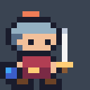
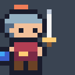
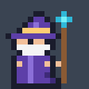
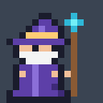

<div align="center">

# 🍬⚔️ Knight of the Snack Realm

### A tiny knight. A kingdom of sweets. One giant slime.

**A pixel-art 2D platformer made in Godot 4. Play it in your browser, on Android or on desktop.**

[](https://severance.lol/1/)
[](https://godotengine.org/)


**[🎮 Play Online](https://severance.lol/1/) · [🗺️ Levels](#levels) · [🕹️ Controls](#controls) · [🧱 Level Editor](#level-editor) · [🛠️ Run Locally](#run-locally)**


</div>

> The Snack Realm used to be a peaceful place. Biscuit forests, gumdrop mountains, a moon made of cheese.
> Then the **Big Slime** showed up, and now everything is covered in goo.
> Grab your sword, eat some fruit, and bonk that jelly back where it came from.

## ✨ Game Highlights

- 🗺️ **6 hand-built levels**, each with its own look, ending in a boss fight
- 🍓 **Sugar Rush**: eat a fruit and turn into a faster, bouncier, *rainbow* knight for a few seconds
- 🍄 **Bounce mushrooms** that fling you into the sky (`BOING!` `SPROING!` `YEET!`)
- ❓ **Mystery blocks**: `?` pops a coin, `!` holds a surprise (fruit, a coin shower, or one very confused slime)
- 🧊 **Crumbly ice** that wobbles, cracks and drops a moment after you step on it, then grows back
- 🌊 **Deadly liquids**: water, goo, lava and icy water. Don't swim.
- 🟢 **Slimes** to stomp, moving platforms to ride, coins to hoard
- 💬 **Comic pop-up text** for almost everything that happens
- 🎯 **Jumping that feels good**: variable jump height, coyote time and jump buffering
- 📱 **Play anywhere**: real multitouch controls on phones, instant restart with one key or tap

> **Ready for an adventure? [▶ Play Knight of the Snack Realm now!](https://severance.lol/1/)**

<a name="levels"></a>

## 🗺️ The journey

| # | Level | What to expect |
|---|-------|----------------|
| 1 | 🍪 **Biscuit Woods** | A gentle walk through crunchy forests. The tutorial, more or less. |
| 2 | 🌉 **Wobblepop Bridge** | Rope bridges over things you really shouldn't fall into. |
| 3 | 🍬 **Gumdrop Heights** | A tall candy tower over a pit of goo. Climb up. Then climb some more. |
| 4 | 🎪 **Cloudtop Circus** | Snow, slippery ice and crumbling ice cubes over freezing water. |
| 5 | 🧀 **Mooncheese Mine** | Dark tunnels, lava and suspiciously yellow rock. |
| 6 | 👑 **The Big Slime** | The boss. Four good head-bonks and the realm is saved. |

<a name="controls"></a>

## 🕹️ Controls

| Action | Keyboard | Touchscreen |
|---|---|---|
| Move | `A` / `D` or `←` / `→` | Left half: slide between ◀ / ▶ arrows |
| Jump | `W` / `↑` / `Space` | Tap the right half |
| Jump higher | Hold the jump key | Hold the right half |
| Restart | `R` | ↻ button in the top-right |

Touch controls appear automatically on phones and tablets, in mobile browsers and Android builds. **Multitouch** lets you move and jump at the same time.

The game is designed for **landscape orientation**. In mobile browsers, portrait mode shows a rotate-device hint. On supported browsers (Android Chrome), the first tap goes fullscreen and locks landscape. On iPhone Safari, use **Add to Home Screen** for an app-like experience.

## 🧙 Coming soon: new heroes

The knight is getting company. A warrior and a mage are already drawn: 16×16 pixel art, generated by a Python script, [`tools/make_sprites.py`](tools/make_sprites.py).

<div align="center">

| Warrior walk | Warrior attack | Mage walk | Mage cast |
|:---:|:---:|:---:|:---:|
|  |  |  |  |

</div>

Run `scenes/hero_showcase.tscn` on its own (`F6`) to see every animation in the engine.

<a name="level-editor"></a>

## 🧱 Make your own levels

Every level is drawn as **ASCII art**. One character is one 16-pixel tile. Select the `LevelMap` node, edit the `map` text in the Inspector, and the level redraws live in the editor.

```
                              F
          ? ! ?             GGGG
   $ $ $          ^     $
@       1     ccc   GGGGG    2
GGGGGGGGGGGwwwwwwGGGGBBBBBGGGGGGG
```

<details>
<summary><b>Tile legend</b></summary>

| Group | Characters |
|-------|-----------|
| **Terrain** (solid) | `G` grass · `B` dirt brick · `S` sand · `T` stone · `C` candy · `P` pink brick · `I` slate ice · `W` snow · `D` dark brick · `H` crate |
| **One-way** (jump up through) | `s` sand ledge · `=` `-` `_` rope bridges (brown, beige, red) |
| **Liquids** (deadly) | `w` water · `g` goo · `l` lava · `i` icy water |
| **Interactive** | `?` coin block · `!` surprise block · `c` crumbly ice · `^` bounce mushroom · `*` sugar fruit |
| **Entities** | `@` player start · `$` coin · `F` goal flag · `1` green slime · `2` purple slime · `X` boss |

The full list lives at the top of [`scripts/level_map.gd`](scripts/level_map.gd).

</details>

<a name="run-locally"></a>

## 🛠️ Run Locally

1. Install [Godot 4.7](https://godotengine.org/) or newer.
2. Clone this repository:

   ```bash
   git clone https://github.com/msveshnikov/godot-2d-game.git
   ```

3. Import/open `project.godot` in Godot.
4. Press **F5** to play.

<details>
<summary><b>🌐 Web (HTML5) export</b></summary>

The included Web export preset supports desktop and mobile browsers:

- **Single-threaded build**: no special COOP/COEP headers needed, so it runs on any static host (GitHub Pages, itch.io, Netlify…) and in iOS Safari.
- **Compatibility (WebGL 2) renderer** on the web. Desktop and Android keep the Mobile renderer.
- **PWA support**: add the game to your phone's home screen and it opens fullscreen in landscape.

Export in **Project → Export → Web → Export Project**, or from the command line (after installing Godot export templates):

```bash
mkdir -p build/web
godot --headless --export-release "Web" build/web/index.html
```

Test locally:

```bash
cd build/web
python -m http.server 8000
```

Open **http://localhost:8000**. To test on a phone connected to the same Wi-Fi network, use your computer's local IP address. Do not open the exported `index.html` directly from disk (`file://`); serve it over HTTP. Installing a PWA from a hosted site requires HTTPS.

For **itch.io**, ZIP the *contents* of `build/web/`, upload as an HTML game, and enable **Mobile friendly** (landscape).

</details>

<details>
<summary><b>🤖 Android export</b></summary>

The repository includes an Android export preset (arm64). Configure the Android SDK and signing settings in Godot, then use **Project → Export → Android**. The project includes Android release configuration; this does not imply that the game is already published on Google Play.

</details>

## 📁 Project Structure

```text
assets/              Sprites, fonts, music, sound effects
scenes/levels/       The 6 levels, from biscuit_woods to big_slime_boss
scenes/objects/      Coin, slime, boss, goal flag, sign, moving platform
scenes/              Player, HUD, title screen, game flow, hero showcase
scripts/             Gameplay logic (level_map.gd is the ASCII level builder)
tools/               make_sprites.py, the pixel-art hero generator
docs/                Images used in this README
project.godot        Godot project settings
export_presets.cfg   Web and Android export configuration
```

## ❤️ Credits

Created with **Godot Engine** by **MaxSoft**. The game assets and visuals are included in the project and designed for its whimsical snack-themed world.

This is a small, self-contained game project you can explore and modify.

---

<div align="center">

### 🍬 Ready to save the Snack Realm?

[](https://severance.lol/1/)

**Made with 🍭 and Godot · Built for fun**

*No snacks were harmed in the making of this game. Several slimes were.*

</div>
