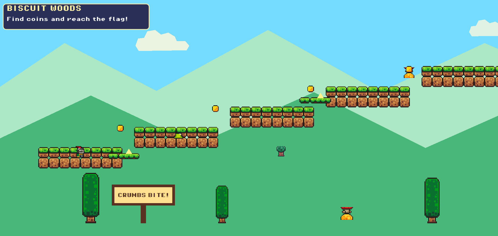

<div align="center">

# 🍬⚔️ Knight of the Snack Realm

### A tiny knight. A kingdom of sweets. One giant slime.

**Jump, collect, and conquer your way through a candy-coated 2D adventure!**

Explore colorful levels, stomp mischievous slimes, dodge tricky hazards, and defeat the mighty **Big Slime** to save the Snack Realm.

[](https://severance.lol/1/)
[](https://godotengine.org/)


**[🎮 Play Online](https://severance.lol/1/) · [🕹️ Controls](#-controls) · [🛠️ Run Locally](#-run-locally)**



</div>

---

## 🌈 Welcome to the Snack Realm

A sweet little world is in big trouble! Take control of a brave knight, leap across moving platforms, grab shiny coins, and battle bouncing slimes. Every level brings new challenges on the way to a showdown with the **Big Slime**.

### ✨ Game Highlights

- 🍭 **Colorful levels** — Explore multiple candy-themed stages.
- 🪙 **Coins and goals** — Collect treasure and reach each finish flag.
- 🟢 **Slime-stomping action** — Jump on enemies to defeat them.
- ⚙️ **Platforming challenges** — Master moving platforms and avoid hazards.
- 👑 **Final boss** — Face the formidable Big Slime.
- 📱 **Play anywhere** — Desktop and mobile browser support, plus Android export.
- 🔄 **Instant retries** — Restart with a single key or tap.

> **Ready for an adventure? [▶ Play Knight of the Snack Realm now!](https://severance.lol/1/)**

## 🕹️ Controls

| Action | Keyboard | Touchscreen |
|---|---|---|
| Move | `A` / `D` or `←` / `→` | Left half: slide between ◀ / ▶ arrows |
| Jump | `W` / `↑` / `Space` | Tap the right half |
| Jump higher | Hold the jump key | Hold the right half |
| Restart | `R` | ↻ button in the top-right |

Touch controls appear automatically on phones and tablets, in mobile browsers and Android builds. **Multitouch** lets you move and jump at the same time.

The game is designed for **landscape orientation**. In mobile browsers, portrait mode shows a rotate-device hint. On supported browsers, tapping the game can enter fullscreen and lock landscape. On iPhone Safari, use **Add to Home Screen** for an app-like experience.

## 🛠️ Run Locally

1. Install [Godot 4.7](https://godotengine.org/) or newer.
2. Clone this repository:

   ```bash
   git clone https://github.com/msveshnikov/godot-2d-game.git
   ```

3. Import/open `project.godot` in Godot.
4. Press **F5** to play.

### 🌐 Web (HTML5) export

The included Web export preset supports desktop and mobile browsers:

- **Single-threaded build** — No special COOP/COEP headers needed.
- **Compatibility (WebGL 2) renderer** on the web.
- **PWA support** — Add the game to your phone's home screen.

Export in **Project → Export → Web → Export Project**, or from the command line (after installing Godot export templates):

```bash
mkdir -p build/web
godot --headless --export-release "Web" build/web/index.html
```

Test locally:

```bash
cd build/web
python -m http.server 8000
```

Open **http://localhost:8000**. To test on a phone connected to the same Wi-Fi network, use your computer's local IP address. Do not open the exported `index.html` directly from disk (`file://`); serve it over HTTP. Installing a PWA from a hosted site requires HTTPS.

For **itch.io**, ZIP the *contents* of `build/web/`, upload as an HTML game, and enable **Mobile friendly** (landscape).

### 🤖 Android export

The repository includes an Android export preset. Configure the Android SDK and signing settings in Godot, then use **Project → Export → Android**. The project includes Android release configuration; this does not imply that the game is already published on Google Play.

## 📁 Project Structure

```text
assets/              Sprites, fonts, music, sound effects
scenes/              Levels, player, HUD, title screen, game objects
scripts/             Gameplay logic and mobile touch controls
project.godot        Godot project settings
export_presets.cfg   Web and Android export configuration
```

## ❤️ Credits

Created with **Godot Engine**. The game assets and visuals are included in the project and designed for its whimsical snack-themed world.

This is a small, self-contained game project you can explore and modify.

---

<div align="center">

### 🍬 Ready to save the Snack Realm?

[](https://severance.lol/1/)

**Made with Godot · Built for fun**

</div>
