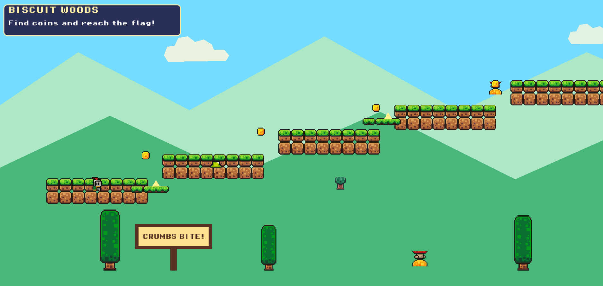

# Knight of the Snack Realm

A small 2D platformer built in Godot 4.7. The player controls a knight exploring a candy-coated world, collecting coins, avoiding hazards, stomping slimes, and defeating a final boss to save the Snack Realm.

**▶ Play in your browser (desktop or mobile): https://severance.lol/1/**



## Gameplay

- Traverse multiple themed levels
- Collect coins and reach the goal flag
- Jump on enemies to defeat them
- Navigate moving platforms and hazards
- Face a boss battle against the Big Slime
- Restart a level quickly with `R`

## Controls

### Keyboard

- `A` / `D` or `Left` / `Right`: move
- `W` / `Up` / `Space`: jump (hold for a higher jump)
- `R`: restart current level

### Touch (phones & tablets)

On-screen controls appear automatically on touch devices, both in the Android build and in mobile browsers:

- **Left half of the screen** – move. Slide your thumb between the ◀ / ▶ arrows to change direction without lifting it.
- **Right half of the screen** – jump. The whole half is the jump area, so you don't have to hit the button exactly; hold for a higher jump.
- **↻ button (top-right)** – restart the current level.

Multitouch works, so you can run and jump at the same time. The game is landscape-only. In a mobile browser, a "rotate your device" hint shows in portrait, and the first tap switches to fullscreen and locks landscape where the browser allows it (Android Chrome; iPhone Safari doesn't support the fullscreen API, so use *Add to Home Screen* instead).

## How to run

1. Install Godot 4.7 or newer.
2. Open this folder in Godot.
3. Open `project.godot`.
4. Press Play or run the main scene.

## Web (HTML5) export

The project includes a **Web** export preset that works on desktop and mobile browsers:

- Single-threaded build (`thread_support=false`), so it does **not** need special `COOP`/`COEP` headers and runs on any static host (GitHub Pages, itch.io, Netlify…) and on iOS Safari.
- Uses the Compatibility (WebGL 2) renderer on web (`rendering_method.web`); desktop and Android keep the Mobile renderer.
- PWA enabled: on a phone you can *Add to Home Screen* and it opens fullscreen in landscape.

**Export from the editor:** *Project → Export… → Web → Export Project* (install the export templates first if Godot asks).

**Export from the command line:**

```sh
godot --headless --export-release "Web" build/web/index.html
```

**Test locally:**

```sh
cd build/web
python -m http.server 8000
```

Then open `http://localhost:8000`. To try it on a phone, open `http://<your-PC-IP>:8000` on the same Wi-Fi network.

> Opening `index.html` straight from disk (`file://`) won't work. Browsers need it served over HTTP. The PWA install option also needs HTTPS (any real host provides it).

**itch.io:** zip the *contents* of `build/web/`, upload it as an HTML game, and enable "Mobile friendly" (landscape).

## Android export

There is also an **Android** preset (arm64). Export it from *Project → Export… → Android*.

## Project structure

- `scenes/` – level and UI scenes
- `scripts/` – gameplay logic and scene behavior (`touch_controls.gd` = on-screen mobile controls)
- `assets/` – art, fonts, music, and sound effects
- `project.godot` – Godot project configuration

## Credits

Assets and visuals are included in the project folder and are designed to fit the whimsical snack-themed world.

## Notes

This project is a lightweight, self-contained Godot game prototype. You can play it locally, in a browser, or on a phone, and modify it as you like.
